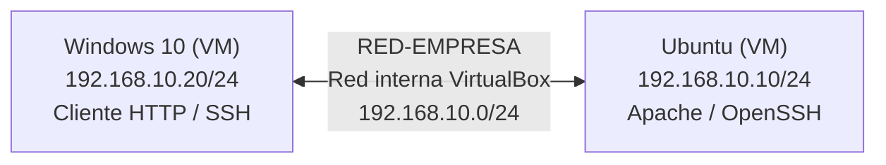
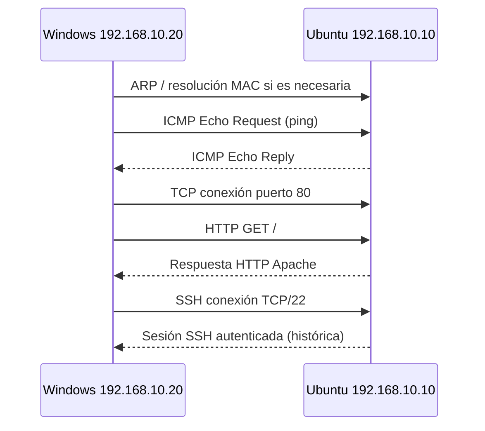
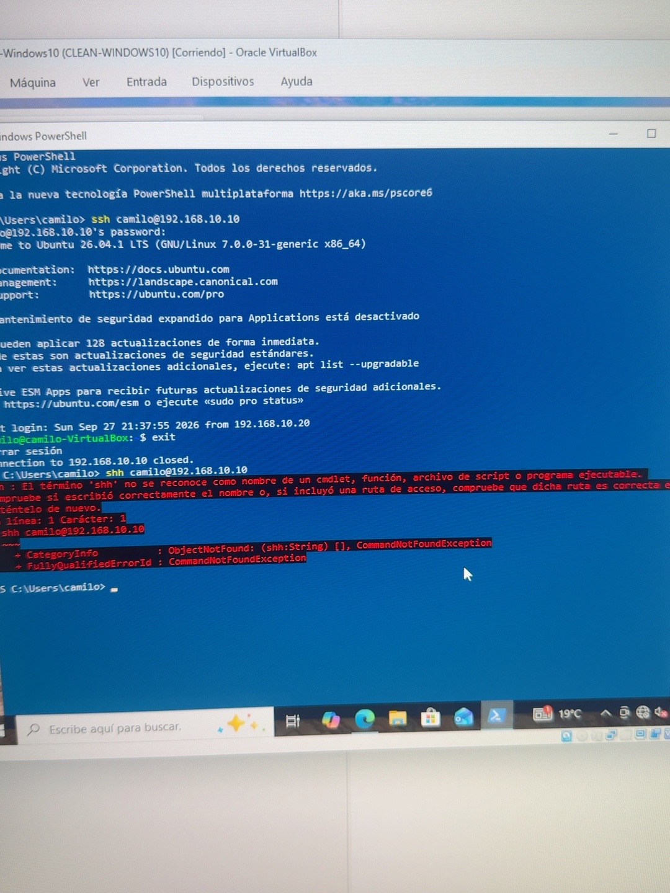
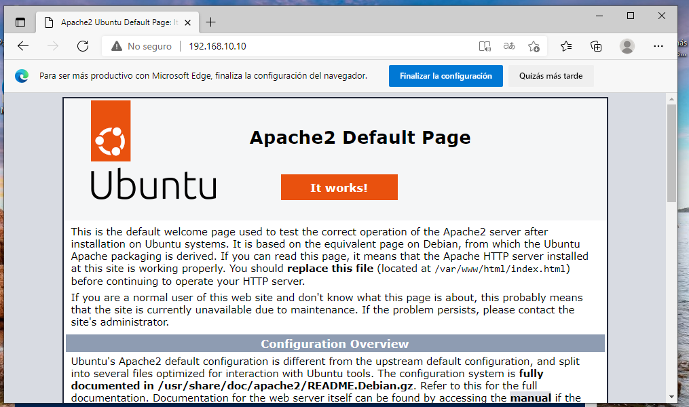

# CyberLab — Redes y ciberseguridad

**Laboratorio académico · IFTS N.º 9 · VirtualBox / Ubuntu / Windows**

La práctica «La PyME vulnerable» utiliza dos máquinas virtuales conectadas por una red interna de VirtualBox. Esta documentación resume **evidencias históricas de septiembre de 2026**, no una inspección en vivo de los equipos en octubre.

## Topología y dirección IPv4



El adaptador NAT temporal utilizado en Ubuntu para descargar paquetes es **distinto** de RED-EMPRESA y su estado actual no está verificado. No hay ruta de salida requerida para la comunicación local entre estas dos IP.

| Nodo | IP de la práctica | Función |
|---|---|---|
| CyberLab-Ubuntu | 192.168.10.10/24 | Servidor web y SSH |
| CyberLab-Windows10 | 192.168.10.20/24 | Cliente y administración remota |

## Trabajo personal y resultados documentados

| Prueba | Resultado en el material histórico | Estado actual |
|---|---|---|
| Direccionamiento /24 | IP .10 y .20 en RED-EMPRESA | Requiere reconfirmación |
| Ping bidireccional | Se registraron pruebas con 4 respuestas y 0% pérdida | Repetir tras cambios |
| HTTP | Página Apache accesible desde navegador Windows | Repetir y confirmar proceso/puerto |
| SSH | Autenticación remota desde Windows hacia Ubuntu | Repetir y auditar configuración |
| Regla ICMP de Windows | Se habilitó Echo Request tras fallo inicial | Revisar si sigue aplicada |
| UFW Linux | Sin evidencia suficiente de estado y reglas | **NO VERIFICADO** |
| Wireshark ICMP/HTTP | Sin capturas finales acreditadas | **PENDIENTE** |
| Webmin y hardening | Sin cierre de instalación ni servicio deshabilitado | **PENDIENTE** |

## Flujo de protocolos



**Esquema didáctico:** el diagrama resume las etapas relacionadas con las pruebas, no es una captura literal de paquetes.

## Auditoría pendiente (comandos de solo lectura)

En Ubuntu, antes de modificar servicios o reglas:

```bash
ip -br -4 addr
ip route
systemctl is-active apache2 ssh ssh.socket
sudo ss -lntup
sudo ufw status verbose
```

En PowerShell dentro de Windows VM:

```powershell
ipconfig
ping -n 4 192.168.10.10
Test-NetConnection 192.168.10.10 -Port 80
Test-NetConnection 192.168.10.10 -Port 22
```

La ejecución anterior de SSH y HTTP **no prueba** que el firewall esté correctamente restringido. Evitar cambiar reglas o deshabilitar servicios hasta registrar su estado y dependencias.

## Evidencias fotográficas recuperadas

Estas capturas se extrajeron del informe de avance del laboratorio de septiembre de 2026. Son **resultados históricos**, no una nueva comprobación del estado actual.

**Conexión SSH autenticada de Windows a Ubuntu**



**Página Apache de Ubuntu accesible desde Windows**



Consulta [el registro de procedencia y limitaciones](evidencias/IMAGENES.md).

## Evidencias fotográficas

Se recuperaron y adjuntaron dos capturas históricas: sesión SSH y página Apache. Las imágenes no acreditan UFW, Wireshark ni el estado de las VM en el presente. Las evidencias adicionales siguen pendientes de captura y revisión de datos privados.

## Documentación de referencia

- «Informe_avance_TP_PyME_vulnerable.docx» (29/09/2026): pruebas de red, HTTP/SSH, límites y pendientes.
- «Auditoria_maestra_CyberLab_y_Cisco.docx» (29/09/2026): inventario histórico, matriz de trazabilidad y plan de continuidad.

**Límite:** los documentos se basan en registros y capturas previas; no se ingresó al host para certificar el estado actual.

[Volver al perfil](https://github.com/Camilo-Guevara) · [Portafolio](https://camilo-guevara.github.io/)