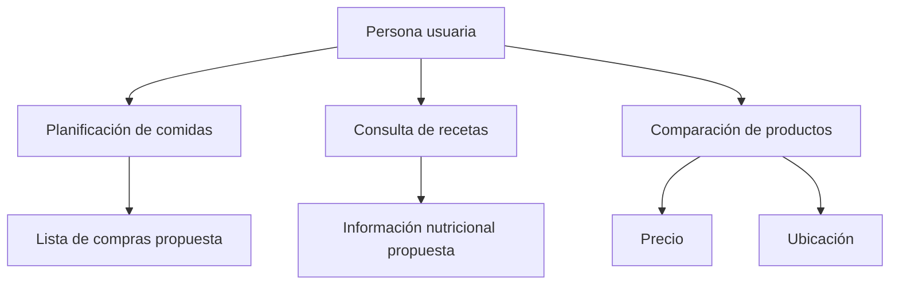

# Frugi App — Análisis y diseño de sistemas

**Proyecto integrador académico · IFTS N.º 9 · Documentación de diseño, no una aplicación desplegada.**

## Problema y propuesta

Frugi App plantea ayudar a comparar productos y recetas teniendo en cuenta **precio, calorías y ubicación**, con herramientas para la planificación de comidas. Las características aquí descritas pertenecen a la propuesta académica y no implican que todas estén implementadas.

## Aportes como analista de sistemas

Mi participación documentada corresponde al análisis y modelado junto a un equipo académico: relevamiento, identificación de requisitos, historias de usuario, priorización de backlog y colaboración en diagramas UML, DER, BPMN y trazabilidad. Los entregables son colaborativos; no atribuyo su autoría exclusiva.

## Entregables de estudio

| Fase | Artefactos trabajados | Alcance |
|---|---|---|
| Hito 1 | Análisis de entorno PESTEL, VRIO, buyer persona y OKR | Evaluación y objetivos propuestos |
| Hito 2 | Relevamiento, backlog MoSCoW, historias de usuario y prototipos | Requisitos/diseño, no funcionalidad publicada |
| Hito 3 | Presentación, costos, evaluación comercial y defensa | Proyecciones, no resultados de ventas |
| Arquitectura | Casos de uso, actividades, secuencias, clases, DER y BPMN | Modelos académicos sujetos a revisión |
| Gestión | EDT/WBS, Gantt, PERT/CPM, seguimiento de riesgos | Planificación, no medición de implementación |

## Diagrama conceptual de funciones

**Diagrama conceptual basado en los documentos de análisis; no representa una arquitectura implementada ni integraciones verificadas.**

## Trazabilidad ilustrativa

| Necesidad | Historia de usuario orientativa | Modelo | Verificación pendiente |
|---|---|---|---|
| Comparar opciones | Como usuario, quiero comparar alternativas para elegir una compra | Caso de uso y actividad | Validación con prototipo y fuentes de precios |
| Revisar recetas | Como usuario, quiero conocer opciones de comidas | Requisitos y modelo de datos | Calidad y procedencia nutricional |
| Planificar comidas | Como usuario, quiero organizar mis comidas | Prototipo y backlog | Usabilidad y alcance del MVP |

Las historias de esta tabla son una **síntesis documental orientativa**, no citas literales de la versión final aprobada del backlog.

## Aspectos de ingeniería considerados

- Calidad de datos y actualización de precios.
- Privacidad de preferencias alimentarias.
- Accesibilidad, usabilidad, seguridad y mantenibilidad.
- Dependencias externas y límites de las APIs.
- Control de alcance: propuestas de IA, OCR, monetización y logística requieren validación y priorización; las diferentes versiones académicas del proyecto no siempre coinciden.

## Fuentes internas revisadas

- «FRUGI APP (1).pdf» — descripción del proyecto y roles.
- «FRUGI APP Hito 1 - Mejoras.pdf» — análisis y propuesta de negocio.
- «Actividad_Clase_1_Retrospectiva_Frugi_App.docx» — retrospectiva y artefactos.
- «Frugi_App_EDT_Gantt_PERT_automatizado.xlsx» — EDT, cronograma y dependencias.
- «Borrador HITO 3.pdf» — borrador de presentación; cifras y alcance preliminares.

**Los documentos originales no se incorporan automáticamente porque pueden contener nombres del equipo, material académico y versiones contradictorias.** Su publicación debe autorizarse y revisarse.

## Fotografías de los informes

Las siguientes imágenes fueron extraídas del informe académico de Frugi App y se presentan como **material visual de diseño**, no como capturas de una aplicación desplegada.

**Prototipo y propuesta visual 1**

**Prototipo y propuesta visual 2**

Consulta [origen y descripción de las imágenes](evidencias/IMAGENES.md). La publicación pública debe respetar los permisos de los autores del trabajo grupal.

## Evidencias y pendientes

- [x] Documentación conceptual basada en materiales académicos existentes.
- [x] Diagrama de alcance conceptual, reproducible en Mermaid.
- [ ] Adjuntar capturas autorizadas de Figma, diagramas UML y matrices originales con procedencia.
- [ ] Conciliar las versiones de hitos, presupuesto, roles y alcance con la versión final del equipo.
- [ ] Identificar qué componentes, si alguno, están ejecutándose en una demo real.

[Volver al perfil](https://github.com/Camilo-Guevara) · [Portafolio](https://camilo-guevara.github.io/)